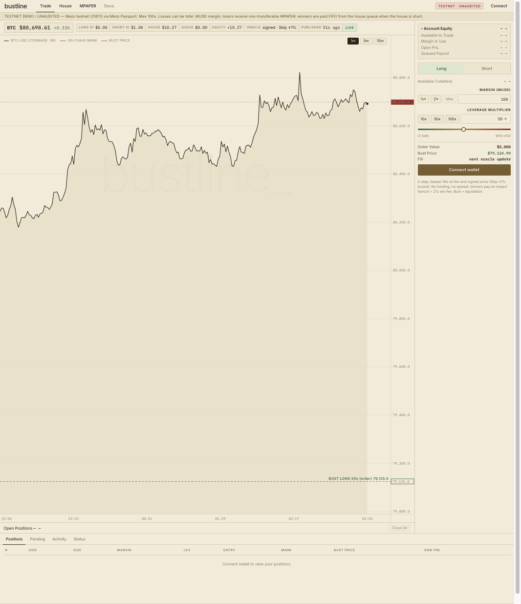

# Bustline

**A 100x BTC/USD perpetual on Mezo, margined in MUSD, where the house is funded only by trader losses.**

> **Testnet demo, unaudited.** Runs on Mezo testnet (chainId `31611`) only. Up to 100x leverage — losses can be total.

- **Live app:** https://bustline.planz.workers.dev (Mezo testnet v3.1, connect with Mezo Passport). The Wave 1 URL
  (bustline-c8p.pages.dev) showed the frozen v2 market and is being retired.
- **Contracts & on-chain proof:** [`docs/DEPLOYMENTS.md`](docs/DEPLOYMENTS.md)
- **Demo video:** _TBD_



## Mezo Buildathon submission

| Requirement / criterion | How Bustline meets it |
|---|---|
| Track | **DeFi** — leveraged trading with MUSD margin, MUSD yield for stakers |
| Integrates MUSD | Margin, house cash, payout queue and staker revenue are all MUSD (real testnet MUSD from a Trove) |
| Working deployment | v3.1 contracts live on **Mezo testnet** behind a timelock (deployed and verified 2026-11-07), keeper Worker running on v3.1; frontend at https://bustline.planz.workers.dev (reads v3.1) |
| Mezo-native stack | Mezo Passport for wallets; prices are keeper-signed and must stay within ±1% of Mezo's MUSD PriceFeed (sourced from Skip Connect); Mezo Pyth pull oracle deployed and verified, switch planned |
| Evidence it works | A real 100x liquidation on testnet driven by the live price feed ([proof](docs/DEPLOYMENTS.md#on-chain-proof)); 103 Foundry unit/fuzz + 46 fork tests (against real Mezo testnet state) + 6 keeper Worker tests + 23 Python keeper tests |

## Try it in 3 minutes


1. **Look without a wallet.** Open https://bustline.planz.workers.dev — the live BTC price, oracle age, house cash, payout
   queue and open interest are read straight from the testnet contracts.
2. **Get testnet funds.** Test BTC from https://faucet.test.mezo.org, then swap BTC → MUSD (or borrow MUSD against BTC)
   in the Mezo testnet dApp at https://testnet.mezo.org.
3. **Connect** with Mezo Passport (Unisat / OKX / Xverse or an EVM wallet) on Mezo testnet.
4. **Trade.** Pick Long or Short, margin ≥ 10 MUSD, leverage up to 100x. The bust (liquidation) price is drawn on the
   chart before you submit. Click *Request long open* (or short) — this approves MUSD and escrows the margin.
5. **Watch the 2-step fill.** The keeper ticks every 15 s and fills your order at the next signed price published *after*
   your request. The position appears under *Positions* with its bust line.
6. **Close or get busted.** Closing in profit pays you from the house (or queues you FIFO if the house is short); a loss
   or a bust mints non-transferable **MPAPER**.
7. **Stake MPAPER** in the *MPAPER* tab to earn a share of MUSD fees; the *House* tab shows the queue and every position.

No testnet MUSD? `./scripts/demo.sh` runs the whole lifecycle — empty house, queued winner, −6% crash, liquidations
repaying the queue, MPAPER staking — on a local fork ([recorded output](docs/demo/crash-demo-output.txt)).

## Deployed contracts (Mezo testnet, chainId 31611)

v3.1 (Wave 2), deployed 2026-11-07 — `deployments/testnet-v3.1.json`. Owner of HouseExchange, both oracles and the
RebateToken = the TimelockController (1-hour delay). Guardian (can pause) and treasury (receives the 1% protocol fee)
= the deployer address. All six contracts are verified on the explorer.

| Contract | Address |
|---|---|
| HouseExchange v3.1 | [`0x3c58314cd5710893519E5d962F553633ECC60cF7`](https://explorer.test.mezo.org/address/0x3c58314cd5710893519E5d962F553633ECC60cF7) |
| SignedPriceOracle (active) | [`0x75a3071482883d9616bf0473B7eE25B4222b181F`](https://explorer.test.mezo.org/address/0x75a3071482883d9616bf0473B7eE25B4222b181F) |
| PythPullOracle (switch-ready) | [`0xf05B4108B93A83a1a87Ba1E392a81226aAC63619`](https://explorer.test.mezo.org/address/0xf05B4108B93A83a1a87Ba1E392a81226aAC63619) |
| RebateToken v3.1 — Mezo Paper (`MPAPER`) | [`0xDACD4786EDCBB626BA95805E204FD18815a389D0`](https://explorer.test.mezo.org/address/0xDACD4786EDCBB626BA95805E204FD18815a389D0) |
| RebateStaking v3.1 | [`0x9bC4C5076752ec7ee0E4e429D6d95229AA147c98`](https://explorer.test.mezo.org/address/0x9bC4C5076752ec7ee0E4e429D6d95229AA147c98) |
| TimelockController | [`0x115ba5242fc96c72cb2971D1B0f25439Def8f1C4`](https://explorer.test.mezo.org/address/0x115ba5242fc96c72cb2971D1B0f25439Def8f1C4) |
| MUSD (Mezo) | [`0x118917a40FAF1CD7a13dB0Ef56C86De7973Ac503`](https://explorer.test.mezo.org/address/0x118917a40FAF1CD7a13dB0Ef56C86De7973Ac503) |

RebateToken v3.1 is a new token: **MPAPER balances and stakes from earlier markets are not carried over.** The
Stability Pool is switched off at deploy; enabling it (`setSpParams`, timelock op B) was scheduled on 2026-11-07 and
executed after the 1-hour delay (execute tx `0x50eb35942b1941733ee03537563fa49bc62a642875a9e2784822205d4df604cd`). No trades have happened on v3.1 yet.

**v3** (2026-11-06, `deployments/testnet-v3.json`, HouseExchange `0x5082…9F58`) is retired: it never had a trade and
the keeper and frontend moved to v3.1, which also carries the review fixes and the pause / protocol fee.
The **v2 market** (Wave 1, `deployments/testnet.json`, HouseExchange `0x5e94…2050`) is frozen as a record: its
owner/keeper key was lost, so it is no longer operated and its open position stays as is. Deploy txs, keys and roles,
the v2 live-liquidation proof and the earlier v1 markets: [`docs/DEPLOYMENTS.md`](docs/DEPLOYMENTS.md).

## What's live vs mocked

| Component | Status |
|---|---|
| Exchange, house, payout queue, MPAPER, staking | **Live** on Mezo testnet with real MUSD (v3.1; no trades on it yet) |
| Price feed | **Live — keeper-signed** median of Coinbase / Kraken / Bitstamp, enforced on-chain to stay within ±1% of Skip Connect |
| Pyth pull oracle | **Deployed, not active.** Verified against Mezo testnet Pyth with a real mainnet-signed update; activating needs a Pyth Hermes API key + one `setOracle` tx |
| Keeper | **Live** as a Cloudflare Worker (cron every minute, 15 s ticks; [health](https://bustline-keeper.planz.workers.dev/health)). Points at v3.1 with `SP_OPS = "1"` and skips fills / liquidations while paused; separate keeper and price-signer keys. Single permissioned operator run by the team (fills, liquidations, price pushes, queue harvest, `rebalance` / `forwardBtc`) |
| Crash-demo market (`deployments/testnet-demo.json`) | **Mocked price** — a separate, labelled market with a `MockOracle` so crashes can be shown on demand |
| Local fork (`dev-fork.sh`, `demo.sh`) | Real MUSD bytecode, **mocked price** (anvil can't run Mezo's Skip precompile) |
| Chart on the trade screen | Display only — Coinbase public candles; settlement uses the on-chain price |

| Wave 2 (v3.1) component | Status |
|---|---|
| HouseExchange v3.1 (Stability Pool, guardian pause, 1% protocol fee), RebateStaking (MUSD + BTC rewards), MUSD PriceFeed bound, TimelockController, new RebateToken | **Deployed 2026-11-07** ([addresses](docs/DEPLOYMENTS.md#v31-wave-2-current--deploymentstestnet-v31json)). All six contracts verified on the explorer. Stability Pool enabled through the timelock (`setSpParams`, 2026-11-07). Replaces v3 (deployed 2026-11-06, Stability Pool enabled through the timelock the same day, never traded, now retired) |
| Keeper-worker v3.1 support (`rebalance` / `forwardBtc`, pause handling, configurable addresses, separate price-signer key) | **Live**: the Worker runs on v3.1 with `SP_OPS = "1"` (2026-11-07) |
| Production frontend (incl. house assets & fees panel, BTC rewards in the MPAPER tab, paused banner) | **Live on v3.1** at https://bustline.planz.workers.dev (2026-11-07) |
| "Start with BTC" / "From my trove" funding routes in the frontend | **Live on the site** (since 2026-11-06, now on v3.1). Read-only views checked on testnet; the signed flows (`openTrove`, `withdrawMUSD`, `repayMUSD`) are not yet verified with real wallets |

## What it is

Bustline is a single-market **BTC/USD synthetic perpetual**. There are no LP deposits: the counterparty is a **house that
starts at 0 MUSD** and grows only from trader losses.

- **Winners** are paid from the house. When the house can't pay, the remainder waits in a **FIFO payout queue** that
  later losses repay. Margin is always returned immediately; only profit can be queued.
- **Losers** receive a **non-transferable rebate token, Mezo Paper (`MPAPER`)**, that can be **staked for MUSD revenue
  share** (fees + house cash above a cap).
- **No funding, no spread.** Winning closes pay an asymmetric impact haircut, then a 2% win fee to stakers and (v3.1) a
  1% protocol fee to the treasury. Positions that cross their bust price are liquidated in full.

The result is a perp that can launch with zero liquidity and never pays out more than it holds: profit beyond house cash
is queued, so house equity (`houseCash − queueTotal`) may go negative while the contract stays fully backed — the invariant
`MUSD held == houseCash + open margin + escrow` is checked after every step in the fuzz/fork tests and the demo.

## Built for Mezo

| | |
|---|---|
| **MUSD everywhere** | Margin, house cash, queue payouts and staker revenue are all MUSD. Testnet MUSD was minted by opening a real MUSD Trove. |
| **Mezo Passport** | The frontend signs every write through Mezo Passport (BTC wallets such as Unisat / OKX / Xverse, plus EVM wallets). |
| **Pyth on Mezo, verified** | Mezo testnet's Pyth contract accepts **mainnet-signed BTC/USD updates** — proven with a real Base-mainnet update in `test/fork/PythFork.t.sol`. `PythPullOracle` is deployed and switch-ready. |
| **Skip Connect as a guard rail** | Every price must be within **±1% of Skip Connect BTC/USD**, Mezo's native oracle. |
| **Oracle-timing safety** | Mezo's Velar PerpDEX was drained via oracle-update timing ([post-mortem](https://mezo.org/blog/velars-perpdex-exploited-on-mezo/)). Bustline makes every open/close **2-step**, so no one can trade against a price they have already seen (below). |

### Wave 2 (v3.1 live on testnet)

The Wave 2 contracts below run on Mezo testnet as v3.1 (deployed 2026-11-07; first deployed as v3 on 2026-11-06) and
are tested (unit, fuzz and fork tests against real Mezo testnet state). The production frontend reads v3.1.

| Mezo primitive | How v3 / v3.1 use it |
|---|---|
| **MUSD `PriceFeed` as the price bound** | `MezoPriceBound` replaces the Skip bound: every signed / Pyth price must be within ±1% of `PriceFeed.fetchPrice()`. If the PriceFeed reverts (e.g. no update for 60 s), the bound is skipped with a `PriceBoundSkipped` event, so fills and liquidations never stop. |
| **Stability Pool for idle house cash** | `rebalance()` (anyone; the keeper calls it) deposits house cash above `spMinLiquid` into the MUSD Stability Pool, capped at `spMaxShareBps` of house assets, and withdraws when cash runs low. Winners are paid from cash, then topped up from the pool, then the FIFO queue. Margin and escrow never go into the pool. Disabled at deploy; enabling it is scheduled in the timelock. |
| **BTC rewards for MPAPER stakers** | BTC collateral gains from Stability Pool liquidations are collected by `forwardBtc()` and distributed by `RebateStaking` v3 next to the MUSD revenue (`claim()` pays both). `receive()` accepts BTC only from the Stability Pool. |
| **Trove funding — "Start with BTC"** | The trade screen reads the trader's trove in `TroveManager` and offers "Start with BTC" (`BorrowerOperations.openTrove{value: BTC}`), "From my trove" (`withdrawMUSD`) or plain MUSD. Hints come from `HintHelpers.getApproxHint` + `SortedTroves.findInsertPosition`. It shows trove ICR, the trove liquidation price next to the position's bust line, the 1,800 MUSD minimum debt, the 200 MUSD gas compensation, and the borrowing rate and fee (read from `InterestRateManager` / `BorrowerOperations`), plus a "Repay trove" button (`repayMUSD`). |

## How a trade works

```text
trader                       HouseExchange                      keeper
  │ requestOpen / requestClose ─▶ escrow margin, record block time
  │                                                     fetch a price published AFTER the request
  │                              executeOrder(id, priceUpdate) ◀─┘  (price update rides in the same tx)
  │                              ├─ verify signature / Pyth proof, staleness ≤ 60 s, within ±1% of Skip
  │                              ├─ publishTime > request time, else revert NotYetFillable
  │ ◀── position opened / closed (profit paid or queued, loss → house + MPAPER minted)
```

- Orders not filled within 5 minutes become refundable. Slippage or OI-cap failures cancel and refund.
- `liquidate(id, priceUpdate)` is permissionless; the keeper calls it with a fresh price in the same tx.

## Mechanics

| | |
|---|---|
| Market | BTC/USD, isolated margin, `size = margin × leverage`, 1–100x, min margin 10 MUSD, max size + per-side OI caps |
| Wins | Deadband (exit measured `entry/50,000` worse) → `scale = (1−base)/(1 + 1/(move·rateMult) + refNotional/(1e6·move·posMult))` (BTC: base 10%, rateMult 15,000, refNotional $100k, posMult 814.598) → 2% win fee to stakers (≈88% of raw gain kept at a 1% move, ≈74% at 0.1%) → v3.1: + 1% protocol fee to the treasury on the same adjusted gain. Both fees only when the winner is paid in full right away (incl. a Stability Pool top-up); queued / partial payouts are fee-free |
| Losses | Lose up to the margin. 2% loss fee goes to stakers **only when the queue is empty and someone is staking**; otherwise 100% to the house |
| Liquidation | Hard bust: trigger = zero-equity price moved 5 bps toward entry; full margin forfeited; 0.5% of margin to the liquidator, 2% to stakers (queue empty). A close that lands past the trigger is treated as a bust |
| Payout queue | `harvest(n)` (anyone; auto-called on each loss) pays FIFO. New winners never jump the queue |
| MPAPER | Minted on realised loss (liquidations: full margin): 100 / MUSD while house equity < threshold, then `flat·(S/(S+H))²` with a ratcheting high-water-mark H. Non-transferable (the owner can enable transfers) |
| Staking | `stake / unstake / claim` MUSD (accumulator). Revenue: loss/win/liquidation fees + house cash above `houseCap` (`sweepExcess`) |

### Revenue model

| Who pays | What | Where it goes |
|---|---|---|
| Winning trader | 2% of the impact-adjusted gain | MPAPER stakers (MUSD) |
| Winning trader (v3.1) | 1% of the same gain (`protocolFeeBps` = 100, capped in the contract) | Treasury — operator revenue that funds the keeper's gas and price updates |
| Losing trader | The loss; 2% of it to stakers only when the queue is empty and someone stakes | House cash (repays the FIFO queue first), stakers |
| Liquidated trader | Full margin; 0.5% to the liquidator, 2% to stakers when the queue is empty and someone stakes | Liquidator, stakers, house |
| Stability Pool | BTC collateral gains on idle house MUSD (`forwardBtc`) | MPAPER stakers (BTC) |

The house has **no seed capital by design**: it is funded only by trader losses, and profit it can't pay right away
waits in the FIFO queue. Fees are only taken when a winner is paid in full on the spot; queued and partial payouts
are fee-free, so the queue never pays the protocol.

## Oracle

Settlement is keeper-driven, so the oracle is **pull-based**: the keeper submits a fresh price update inside the same tx
as `executeOrder` / `liquidate` (`msg.value` pays the update fee). `HouseExchange` only talks to `IPriceOracle`, and the
owner can switch sources with one `setOracle` tx.

| Source | Trust | Status |
|---|---|---|
| **Pyth pull** (`oracles/PythPullOracle`) — Mezo Pyth `updatePriceFeeds`, maxAge 60 s, conf ≤ 1%, Skip ±1% | Wormhole guardians; trustless w.r.t. the keeper | Deployed and verified on Mezo testnet. Going live only needs a Pyth Hermes API key (`PYTH_API_KEY`) and one `setOracle` call |
| **Keeper-signed** (`oracles/SignedPriceOracle`) — EIP-191 report `(chainid, oracle, price, publishTime)`; newer than stored, ≤ 10 s in the future, maxAge 60 s, within 1% of Skip | Trusts the signer inside the ±1% Skip band, and for liveness | **Active on testnet.** Price = median of Coinbase / Kraken / Bitstamp spot (≥ 2 sources, ≤ 0.5% spread) |

If Skip itself is stale (> 300 s) the ±1% bound is skipped, so a Skip outage can't freeze the market; the primary
oracle's own staleness check still applies.

## Repository layout

| Path | What |
|---|---|
| `src/` | `HouseExchange`, `RebateToken` (MPAPER), `RebateStaking`, `libraries/ImpactLib`, `oracles/` (Pyth pull, signed, Skip bound, MUSD PriceFeed bound `MezoPriceBound`), `interfaces/IMezo.sol` (Mezo MUSD protocol), mocks |
| `test/` | Unit + fuzz (`HouseExchange.t.sol`, `Oracles.t.sol`, `MezoPriceBound.t.sol`, `StabilityPool.t.sol`, `RebateStakingV3.t.sol`, `Timelock.t.sol`; Mezo mocks in `test/mocks/`); fork suites against real testnet MUSD, Mezo Pyth with a mainnet-signed update, and the real PriceFeed / Stability Pool / BorrowerOperations (`test/fork/`) |
| `script/` | `DeployLocal` (anvil), `DeployTestnet` (v2, `ORACLE_MODE=signed\|pyth`), `DeployTestnetV3` (Wave 2: timelock + new RebateToken + v3, broadcast 2026-11-06, retired), `DeployTestnetV3_1` (v3.1: + guardian pause and protocol fee, broadcast 2026-11-07, live), `DeployTestnetDemo` (mock-oracle crash-demo market) |
| `scripts/` | `dev-fork.sh` (anvil fork + deploy), `demo.sh` (crash/volatility demo), `export-abi.sh`, `list-events.py` |
| `keeper-worker/` | Live keeper on Cloudflare Workers (TypeScript + viem port of the Python keeper, `/health` endpoint) |
| `keeper/` | Python keeper (fills, liquidations, queue harvest, optional Telegram alerts; v2-only — it never calls the v3 / v3.1 functions, even though `keeper/abi` was regenerated for v3.1, and v2 is frozen) + testnet operator CLI |
| `frontend/` | Next.js 14 + Mezo Passport: trade screen with bust lines, positions, house & payout queue, MPAPER staking; Wave 2 trove funding routes (`components/Funding.tsx`, `lib/mezo.ts`) |
| `docs/` | [`DEPLOYMENTS.md`](docs/DEPLOYMENTS.md) (addresses + on-chain events), [`OPERATIONS.md`](docs/OPERATIONS.md) (deploy & run), `demo/` (recorded outputs) |

## Run it

Requires [Foundry](https://book.getfoundry.sh/), Python 3, Node 18+ and [pnpm](https://pnpm.io/) 10.16+ (`frontend/` and
`keeper-worker/` pin `pnpm@10.33.2` via `packageManager`).

```bash
git clone --recurse-submodules https://github.com/naoto13/Bustline.git && cd Bustline

forge test --no-match-path 'test/fork/**'                   # unit + fuzz: 103 tests
MEZO_FORK_URL=https://rpc.test.mezo.org forge test --match-path 'test/fork/*'   # 46 fork tests against real Mezo testnet state (read-only)

./scripts/dev-fork.sh                                       # anvil fork of Mezo testnet + deploy (unlocked anvil accounts, no keys)
./scripts/demo.sh                                           # crash/volatility demo → docs/demo/crash-demo-output.txt
(cd keeper && python3 -m unittest discover -s tests)        # 23 Python keeper tests
(cd keeper-worker && pnpm install --frozen-lockfile && pnpm test)   # 6 keeper Worker tests (pause handling)
(cd keeper && python3 -m perp_keeper --execute-local --simulate-oracle)   # keeper loop on the local fork
(cd frontend && pnpm install --frozen-lockfile && pnpm build && pnpm start)  # http://localhost:3100
```

The crash demo walks through the whole lifecycle — empty house → winner queued → 100x and 20x longs busted by a −6% move
→ their margin repays the queue → MPAPER staked and transfer rejected. Output:
[`docs/demo/crash-demo-output.txt`](docs/demo/crash-demo-output.txt).

Testnet deployment and keeper operation: [`docs/OPERATIONS.md`](docs/OPERATIONS.md).

## Security & limitations

- **Unaudited hackathon build.** Single market, isolated margin, no partial closes, no session keys or relayer.
- **Admin powers.** The owner can switch the oracle, whitelist keepers, change risk/fee/impact/mint-curve parameters,
  rotate the price signer and enable MPAPER transfers. On v3.1 (and v3) every one of these goes through the timelock. On the
  frozen v2 market the owner, keeper and price signer were one EOA.
- **Timelock and key separation (v3 / v3.1).** v3.1 puts HouseExchange, both oracles and the RebateToken under an
  OpenZeppelin `TimelockController` (testnet delay **1 hour**; mainnet should use 48 h or more). Proposer/canceller is
  the deployer; anyone can execute a ready operation. The owner (timelock proposer), keeper and price signer are three
  different keys, so a leaked keeper key cannot call owner functions. Production would still need a multisig proposer.
- **Emergency pause (v3.1).** A `guardian` (or the owner) can `pause()` immediately; only the owner — the timelock —
  can `unpause()`, so resuming always waits the delay. While paused, `requestOpen`, `executeOrder`, `liquidate`,
  `sweepExcess` and Stability Pool deposits revert / are skipped; `requestClose` (filled after unpause),
  `cancelExpired`, `harvest`, pool withdrawals, `forwardBtc`, price pushes and staking keep working. v2 and v3 have no
  pause. Runbook: [`docs/OPERATIONS.md`](docs/OPERATIONS.md#5-emergency-pause-v31).
- **Stability Pool risk (v3.1).** Liquidations of troves below 100% ICR shrink the house's pool deposit (shown as a house
  loss in `houseEquity`). Pool withdrawals are blocked while the lowest-ICR trove is below MCR (110%) or the PriceFeed is
  down — typically during a BTC crash, when shorts are winning. v3.1 keeps `spMinLiquid` in cash, caps the pool share,
  never deposits while withdrawals are blocked, and queues any unpaid profit FIFO. On Mezo testnet the lowest trove was
  at ≈109.3% ICR (below MCR) on 2026-11-02, so pool withdrawals were blocked then; by 2026-11-06 it was back at
  ≈113%. The state moves with the BTC price.
- **Trove funding is 3 transactions.** Mezo Passport's BTC wallets (Unisat / OKX / Xverse) are Safe smart accounts that
  send one call per signature (no batching, no `signTypedData`), so "Start with BTC" is `openTrove` → `approve` (first
  time only) → `requestOpen`. If a later step fails, the borrowed MUSD stays in the trader's wallet and the flow resumes
  from that step (checked read-only so far, not yet with real signed transactions).
- **Python keeper is legacy / v2-only.** `keeper/` has no code for the v3 functions (`rebalance`, `forwardBtc`,
  Stability Pool views), does not know the v3.1 pause, and defaults to `deployments/testnet.json` (frozen v2). Only the
  Cloudflare Worker keeper supports v3 / v3.1, so there is no working fallback keeper today.
- The v3.1 testnet market uses the keeper-signed oracle until a Pyth Hermes API key is configured; the Pyth path is
  deployed and tested.
- The keeper set is permissioned (owner whitelist) so traders can't time their own fills; expired orders are refundable.
- Skip on Mezo testnet returns `answeredInRound = 0`, so the Skip adapter relies on `updatedAt` freshness only.
- Anvil can't execute Mezo's Skip precompile, so local/fork runs use `MockOracle`; MUSD is the real bytecode.
- Impact-haircut and mint-curve parameters start from published defaults of the reference designs below and are not
  yet tuned for Mezo.

## Operations & mainnet path

Today (testnet):

- **Guardian pause (v3.1)** — immediate stop by the guardian; resume only through the timelock.
- **Timelock, 1-hour delay** — every admin change (oracle, keepers, fees, Stability Pool params, unpause) is
  scheduled and executed after the delay.
- **One permissioned keeper on Cloudflare Workers** — cron every minute, fills / liquidations / price pushes / harvest /
  rebalance, `/health` endpoint; it skips fills and liquidations while the exchange is paused. Runbook:
  [`docs/OPERATIONS.md`](docs/OPERATIONS.md).

Planned before mainnet:

- Switch settlement to **Pyth pull** (`setOracle` to the deployed `PythPullOracle`) once a Hermes API key is set.
- **Multisig** as timelock proposer (today the deployer EOA) and a longer delay (48 h+).
- External **audit**.
- **Caps** sized for launch: per-side OI caps, max position size and max leverage tuned to the house size.

## Wave log

Per-wave details and tags: [CHANGELOG.md](CHANGELOG.md).

| Wave | Dates | Shipped |
|---|---|---|
| Wave 1 | Oct 16–26, 2026 | Core exchange (2-step fills, hard-bust liquidation, FIFO payout queue, impact haircut), MPAPER + staking, Pyth / signed / Skip oracles, Python keeper and its Cloudflare Worker port, Next.js + Mezo Passport frontend, testnet deployment and a live liquidation |
| Wave 2 | Nov 2–15, 2026 | **v3.1 live on testnet (2026-11-07)**, after v3 (2026-11-06, retired without trades). Done: MUSD PriceFeed price bound, HouseExchange with Stability Pool deposits and BTC rewards to MPAPER stakers, TimelockController + separate owner / keeper / price-signer keys, a new RebateToken (v2 frozen after its key was lost; MPAPER balances not carried over), guardian emergency pause (unpause only via the timelock), 1% protocol fee to a treasury, fixes from an independent review, keeper Worker and production frontend on v3.1, all six v3.1 contracts verified, "Start with BTC" / "From my trove" funding routes, pnpm migration; 103 unit/fuzz + 46 fork + 6 keeper Worker + 23 Python keeper tests. Stability Pool enabled on v3.1 through the timelock (2026-11-07). First v3.1 trades from two scripted test wallets (2026-11-07): all three funding routes, wins paid with the protocol fee and the staker fee ([txs](docs/DEPLOYMENTS.md#v31-test-wallet-trades-2026-11-07)). First Stability Pool deposit after lowering the floor through the timelock (2026-11-10). Remaining: trades by outside users |

## Team

Built by [**PLAN-Z**](https://planz.tech), a Japan-based Web3 product studio (with bases in Vietnam and Thailand) that
has launched 10 products since 2020 and operates them in-house — including GamingDEX (a Balancer-fork DEX on OASYS L1),
Neptune (liquid staking on OASYS L1), GEEK Staking (monthly USDC rewards) and DeFiVerse (its own OASYS L2). PLAN-Z also
runs Yield Farming Lab, a DeFi community of ~15,000 members, and CryptoLoungeGOX, a crypto event lounge in Shinjuku, Tokyo.

## Credits

Bustline is an independent implementation built on [OpenZeppelin Contracts](https://github.com/OpenZeppelin/openzeppelin-contracts)
and [forge-std](https://github.com/foundry-rs/forge-std). The mechanism design draws on public documentation:
[Papertrade](https://docs.papertrade.xyz/) (asymmetric impact PnL, solvency & payout queue, mint curve — the name
"Mezo Paper" is a nod to it), Rollbit's market-impact PnL model, and Mezo's Velar PerpDEX post-mortem.
Not affiliated with any of them.

## License

[MIT](LICENSE). Testnet demo — use at your own risk.
