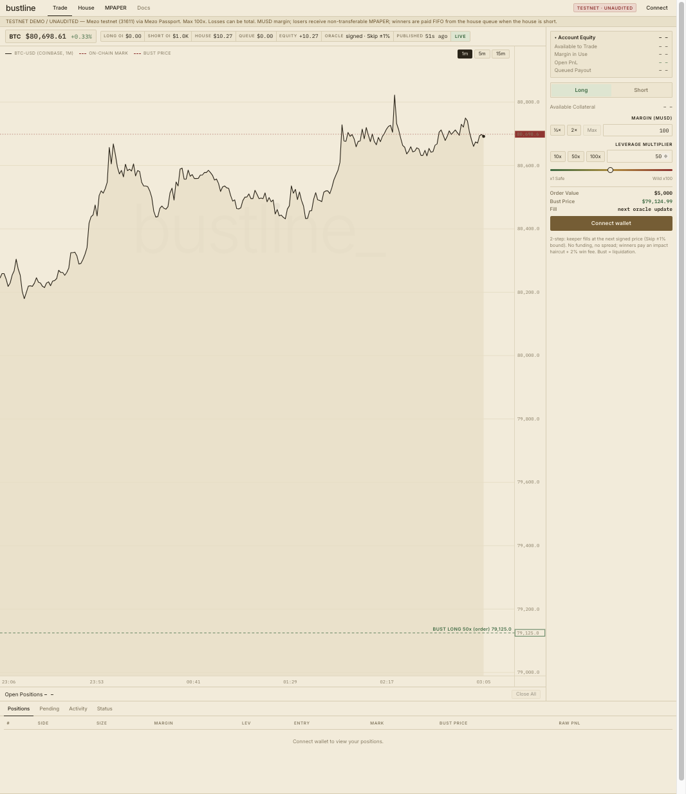

# Bustline

**A 100x BTC/USD perpetual on Mezo, margined in MUSD, where the house is funded only by trader losses.**

> **Testnet demo, unaudited.** Runs on Mezo testnet (chainId `31611`) only. Up to 100x leverage — losses can be total.

- **Live app:** https://bustline-c8p.pages.dev (Mezo testnet, connect with Mezo Passport)
- **Contracts & on-chain proof:** [`docs/DEPLOYMENTS.md`](docs/DEPLOYMENTS.md)
- **ピッチ動画（1分59秒）:** https://youtu.be/CWIY4ftYORI
- **Wave 1 審査資料:** [試し方・実装範囲・証跡](docs/WAVE1-JUDGE-GUIDE.md) / [PDFデッキ](docs/wave1/bustline-wave1-deck.pdf)



## Mezo Buildathon submission

| Requirement / criterion | How Bustline meets it |
|---|---|
| Track | **DeFi** — leveraged trading with MUSD margin, MUSD yield for stakers |
| Integrates MUSD | Margin, house cash, payout queue and staker revenue are all MUSD (real testnet MUSD from a Trove) |
| Working deployment | Contracts live on **Mezo testnet**, keeper running, frontend at https://bustline-c8p.pages.dev |
| Mezo-native stack | Mezo Passport、現在はチーム署名価格。Pyth はデプロイ・フォーク検証済みで未稼働。Skip の ±1% 制限は有効かつ新鮮なデータがある場合のみ |
| Evidence it works | A real 100x liquidation on testnet driven by the live price feed ([proof](docs/DEPLOYMENTS.md#on-chain-proof)); 33 Foundry + 23 keeper tests |

## Try it in 3 minutes

1. **Look without a wallet.** Open https://bustline-c8p.pages.dev — the live BTC price, oracle age, house cash, payout
   queue and open interest are read straight from the testnet contracts.
2. **Get testnet funds.** Test BTC from https://faucet.test.mezo.org, then swap BTC → MUSD (or borrow MUSD against BTC)
   in the Mezo testnet dApp at https://testnet.mezo.org.
3. **Connect** with Mezo Passport (Unisat / OKX / Xverse or an EVM wallet) on Mezo testnet.
4. **Trade.** Pick Long or Short, margin ≥ 10 MUSD, leverage up to 100x. The bust (liquidation) price is drawn on the
   chart before you submit. Click *Request long open* (or short) — this approves MUSD and escrows the margin.
5. **Watch the 2-step fill.** The keeper ticks every 15 s and fills your order at the next signed price published *after*
   your request. The position appears under *Positions* with its bust line.
6. **Close or get busted.** Closing in profit pays you from the house (or queues you FIFO if the house is short); a loss
   or a bust mints non-transferable **MPAPER**.
7. **Stake MPAPER** in the *MPAPER* tab to earn a share of MUSD fees; the *House* tab shows the queue and every position.

No testnet MUSD? `./scripts/demo.sh` runs the whole lifecycle — empty house, queued winner, −6% crash, liquidations
repaying the queue, MPAPER staking — on a local fork ([recorded output](docs/demo/crash-demo-output.txt)).

## Deployed contracts (Mezo testnet, chainId 31611)

| Contract | Address |
|---|---|
| HouseExchange | [`0x5e941EEA56DEE50924950E86f24624Be37f02050`](https://explorer.test.mezo.org/address/0x5e941EEA56DEE50924950E86f24624Be37f02050) |
| SignedPriceOracle (active) | [`0x83401Fc1B16DbCa09531241Dad49700248C8c72c`](https://explorer.test.mezo.org/address/0x83401Fc1B16DbCa09531241Dad49700248C8c72c) |
| PythPullOracle (switch-ready) | [`0xA1E556D9e659fC879D3c37Bd2490D3274B6c20bB`](https://explorer.test.mezo.org/address/0xA1E556D9e659fC879D3c37Bd2490D3274B6c20bB) |
| RebateToken — Mezo Paper (`MPAPER`) | [`0x07F9bd344916571321f494aE00eDD30ac1dE89Bd`](https://explorer.test.mezo.org/address/0x07F9bd344916571321f494aE00eDD30ac1dE89Bd) |
| RebateStaking | [`0x8c76076af61489D8fdc10F6DbA7a9aeC52879fD8`](https://explorer.test.mezo.org/address/0x8c76076af61489D8fdc10F6DbA7a9aeC52879fD8) |
| MUSD (Mezo) | [`0x118917a40FAF1CD7a13dB0Ef56C86De7973Ac503`](https://explorer.test.mezo.org/address/0x118917a40FAF1CD7a13dB0Ef56C86De7973Ac503) |

Deploy txs, the live-liquidation tx and the earlier v1 markets: [`docs/DEPLOYMENTS.md`](docs/DEPLOYMENTS.md).

## What's live vs mocked

| Component | Status |
|---|---|
| Exchange, house, payout queue, MPAPER, staking | **Live** on Mezo testnet with real MUSD |
| Price feed | **稼働中 — チーム署名**の Coinbase / Kraken / Bitstamp 中央値。Skip が有効かつ新鮮な場合に ±1% 制限。古い・無効な Skip データでは制限を迂回 |
| Pyth pull oracle | **デプロイ・フォーク検証済み、未稼働。** 署名更新データで検証。データ取得と移行の検証後、管理者の `setOracle` で切替 |
| Keeper | **Live** as a Cloudflare Worker (cron every minute, 15 s ticks; [health](https://bustline-keeper.m9m1c3.workers.dev/health)). Single permissioned operator run by the team (fills, liquidations, price pushes, queue harvest); the Python keeper is the fallback |
| Crash-demo market (`deployments/testnet-demo.json`) | **Mocked price** — a separate, labelled market with a `MockOracle` so crashes can be shown on demand |
| Local fork (`dev-fork.sh`, `demo.sh`) | Real MUSD bytecode, **mocked price** (anvil can't run Mezo's Skip precompile) |
| Chart on the trade screen | Display only — Coinbase public candles; settlement uses the on-chain price |

## What it is

Bustline is a single-market **BTC/USD synthetic perpetual**. There are no LP deposits: the counterparty is a **house that
starts at 0 MUSD** and grows only from trader losses.

- **Winners** are paid from the house. When the house can't pay, the remainder waits in a **FIFO payout queue** that
  later losses repay. Margin is always returned immediately; only profit can be queued.
- **Losers** receive a **non-transferable rebate token, Mezo Paper (`MPAPER`)**, that can be **staked for MUSD revenue
  share** (fees + house cash above a cap).
- **No funding, no spread.** Winning closes pay an asymmetric impact haircut + 2% win fee. Positions that cross their
  bust price are liquidated in full.

外部 LP の預入なしで開始できますが、支払いキューは返済保証ではありません。ハウス純資産
(`houseCash − queueTotal`) は負になり得て、利益の支払い日は保証されません。
`MUSD held == houseCash + open margin + escrow` は会計上の資金分離を検証する式であり、
キュー内の利益債務の全額裏付けを示しません。利益決済では証拠金を返しますが、損失や清算では証拠金を失います。
MPAPER の報酬も将来の収益次第で、損失補償・固定 APY ではありません。

## Built for Mezo

| | |
|---|---|
| **MUSD everywhere** | Margin, house cash, queue payouts and staker revenue are all MUSD. Testnet MUSD was minted by opening a real MUSD Trove. |
| **Mezo Passport** | The frontend signs every write through Mezo Passport (BTC wallets such as Unisat / OKX / Xverse, plus EVM wallets). |
| **Pyth on Mezo, verified** | Mezo testnet's Pyth contract accepts **mainnet-signed BTC/USD updates** — proven with a real Base-mainnet update in `test/fork/PythFork.t.sol`. `PythPullOracle` is deployed and switch-ready. |
| **Skip Connect as a guard rail** | 有効かつ新鮮な Skip Connect BTC/USD がある場合に **±1%** 制限。古い・無効・無効化された Skip では迂回。 |
| **Oracle-timing safety** | 注文より後の公開時刻を持つ価格で約定する **2段階方式**。既知価格での約定を抑制しますが、署名者・キーパーの信頼やタイミングリスクは残ります。 |

## How a trade works

```text
trader                       HouseExchange                      keeper
  │ requestOpen / requestClose ─▶ escrow margin, record block time
  │                                                     fetch a price published AFTER the request
  │                              executeOrder(id, priceUpdate) ◀─┘  (price update rides in the same tx)
  │                              ├─ verify signature / Pyth proof, staleness ≤ 60 s; Skip bound only when valid and fresh
  │                              ├─ publishTime > request time, else revert NotYetFillable
  │ ◀── position opened / closed (profit paid or queued, loss → house + MPAPER minted)
```

- Orders not filled within 5 minutes become refundable. Slippage or OI-cap failures cancel and refund.
- `liquidate(id, priceUpdate)` is permissionless; the keeper calls it with a fresh price in the same tx.

## Mechanics

| | |
|---|---|
| Market | BTC/USD, isolated margin, `size = margin × leverage`, 1–100x, min margin 10 MUSD, max size + per-side OI caps |
| Wins | Deadband (exit measured `entry/50,000` worse) → `scale = (1−base)/(1 + 1/(move·rateMult) + refNotional/(1e6·move·posMult))` (BTC: base 10%, rateMult 15,000, refNotional $100k, posMult 814.598) → 2% win fee. ≈88% of raw gain kept at a 1% move, ≈74% at 0.1% |
| Losses | Lose up to the margin. 2% loss fee goes to stakers **only when the queue is empty and someone is staking**; otherwise 100% to the house |
| Liquidation | Hard bust: trigger = zero-equity price moved 5 bps toward entry; full margin forfeited; 0.5% of margin to the liquidator, 2% to stakers (queue empty). A close that lands past the trigger is treated as a bust |
| Payout queue | `harvest(n)` (anyone; auto-called on each loss) pays FIFO. New winners never jump the queue |
| MPAPER | Minted on realised loss (liquidations: full margin): 100 / MUSD while house equity < threshold, then `flat·(S/(S+H))²` with a ratcheting high-water-mark H. Non-transferable (the owner can enable transfers) |
| Staking | `stake / unstake / claim` MUSD (accumulator). Revenue: loss/win/liquidation fees + house cash above `houseCap` (`sweepExcess`) |

## Oracle

Settlement is keeper-driven, so the oracle is **pull-based**: the keeper submits a fresh price update inside the same tx
as `executeOrder` / `liquidate` (`msg.value` pays the update fee). `HouseExchange` only talks to `IPriceOracle`, and the
owner can switch sources with one `setOracle` tx.

| Source | Trust | Status |
|---|---|---|
| **Pyth pull** (`oracles/PythPullOracle`) — Mezo Pyth `updatePriceFeeds`, maxAge 60 s, conf ≤ 1%, Skip ±1% | Wormhole guardians; trustless w.r.t. the keeper | Deployed and verified on Mezo testnet. 未稼働。データ取得・移行の検証と管理者の `setOracle` が必要 |
| **Keeper-signed** (`oracles/SignedPriceOracle`) — EIP-191 report `(chainid, oracle, price, publishTime)`; newer than stored, ≤ 10 s in the future, maxAge 60 s, within 1% of Skip | 署名者と稼働継続を信頼。Skip の制限は有効・新鮮な場合のみ | **Active on testnet.** Price = median of Coinbase / Kraken / Bitstamp spot (≥ 2 sources, ≤ 0.5% spread) |

If Skip itself is stale (> 300 s) the ±1% bound is skipped, so a Skip outage can't freeze the market; the primary
oracle's own staleness check still applies.

## Repository layout

| Path | What |
|---|---|
| `src/` | `HouseExchange`, `RebateToken` (MPAPER), `RebateStaking`, `libraries/ImpactLib`, `oracles/` (Pyth pull, signed, Skip bound), mocks |
| `test/` | Unit + fuzz (`HouseExchange.t.sol`, `Oracles.t.sol`); fork suites against real testnet MUSD and real Mezo Pyth with a mainnet-signed update (`test/fork/`) |
| `script/` | `DeployLocal` (anvil), `DeployTestnet` (`ORACLE_MODE=signed\|pyth`), `DeployTestnetDemo` (mock-oracle crash-demo market) |
| `scripts/` | `dev-fork.sh` (anvil fork + deploy), `demo.sh` (crash/volatility demo), `export-abi.sh`, `list-events.py` |
| `keeper-worker/` | Live keeper on Cloudflare Workers (TypeScript + viem port of the Python keeper, `/health` endpoint) |
| `keeper/` | Python keeper (fills, liquidations, queue harvest, optional Telegram alerts; fallback) + testnet operator CLI |
| `frontend/` | Next.js 14 + Mezo Passport: trade screen with bust lines, positions, house & payout queue, MPAPER staking |
| `docs/` | [`DEPLOYMENTS.md`](docs/DEPLOYMENTS.md) (addresses + on-chain events), [`OPERATIONS.md`](docs/OPERATIONS.md) (deploy & run), `demo/` (recorded outputs) |

## Run it

Requires [Foundry](https://book.getfoundry.sh/), Python 3 and Node 18+.

```bash
git clone --recurse-submodules https://github.com/naoto13/Bustline.git && cd Bustline

forge test                                                  # unit + fuzz (fork suites auto-skip)
MEZO_FORK_URL=https://rpc.test.mezo.org forge test --match-path 'test/fork/*'   # against real Mezo testnet state (read-only)

./scripts/dev-fork.sh                                       # anvil fork of Mezo testnet + deploy (unlocked anvil accounts, no keys)
./scripts/demo.sh                                           # crash/volatility demo → docs/demo/crash-demo-output.txt
(cd keeper && python3 -m unittest discover -s tests)        # keeper tests
(cd keeper && python3 -m perp_keeper --execute-local --simulate-oracle)   # keeper loop on the local fork
(cd frontend && npm ci --legacy-peer-deps && npm run build && npm start)  # http://localhost:3100
```

The crash demo walks through the whole lifecycle — empty house → winner queued → 100x and 20x longs busted by a −6% move
→ their margin repays the queue → MPAPER staked and transfer rejected. Output:
[`docs/demo/crash-demo-output.txt`](docs/demo/crash-demo-output.txt).

Testnet deployment and keeper operation: [`docs/OPERATIONS.md`](docs/OPERATIONS.md).

## Security & limitations

- **Unaudited hackathon build.** Single market, isolated margin, no partial closes, no session keys or relayer.
- **Admin powers.** The owner can switch the oracle, whitelist keepers, change risk/fee/impact/mint-curve parameters,
  rotate the price signer and enable MPAPER transfers. On testnet the owner is a single EOA; production would need a
  multisig + timelock.
- The live testnet market uses the keeper-signed oracle until a Pyth Hermes API key is configured; the Pyth path is
  deployed and tested.
- The keeper set is permissioned (owner whitelist) so traders can't time their own fills; expired orders are refundable.
- Skip on Mezo testnet returns `answeredInRound = 0`, so the Skip adapter relies on `updatedAt` freshness only.
- Anvil can't execute Mezo's Skip precompile, so local/fork runs use `MockOracle`; MUSD is the real bytecode.
- Impact-haircut and mint-curve parameters start from published defaults of the reference designs below and are not
  yet tuned for Mezo.

## Wave log

| Wave | Dates | Shipped |
|---|---|---|
| Wave 1 | Oct 16–26, 2026 | Core exchange (2-step fills, hard-bust liquidation, FIFO payout queue, impact haircut), MPAPER + staking, Pyth / signed / Skip oracles, Python keeper and its Cloudflare Worker port, Next.js + Mezo Passport frontend, testnet deployment and a live liquidation |
| Wave 2 | Nov 2–15, 2026 | _Planned — updated at submission_ |

## Team

Built by [**PLAN-Z**](https://planz.tech), a Japan-based Web3 product studio (with bases in Vietnam and Thailand) that
has launched 10 products since 2020 and operates them in-house — including GamingDEX (a Balancer-fork DEX on OASYS L1),
Neptune (liquid staking on OASYS L1), GEEK Staking (monthly USDC rewards) and DeFiVerse (its own OASYS L2). PLAN-Z also
runs Yield Farming Lab, a DeFi community of ~15,000 members, and CryptoLoungeGOX, a crypto event lounge in Shinjuku, Tokyo.

## Credits

Bustline is an independent implementation built on [OpenZeppelin Contracts](https://github.com/OpenZeppelin/openzeppelin-contracts)
and [forge-std](https://github.com/foundry-rs/forge-std). The mechanism design draws on public documentation:
[Papertrade](https://docs.papertrade.xyz/) (asymmetric impact PnL, solvency & payout queue, mint curve — the name
"Mezo Paper" is a nod to it), Rollbit's market-impact PnL model, and Mezo's Velar PerpDEX post-mortem.
Not affiliated with any of them.

## License

[MIT](LICENSE). Testnet demo — use at your own risk.
